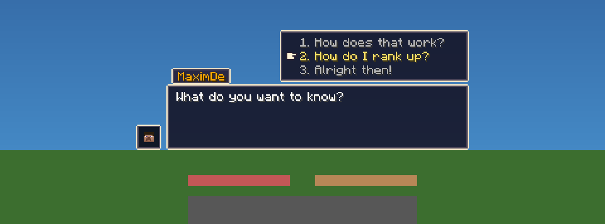
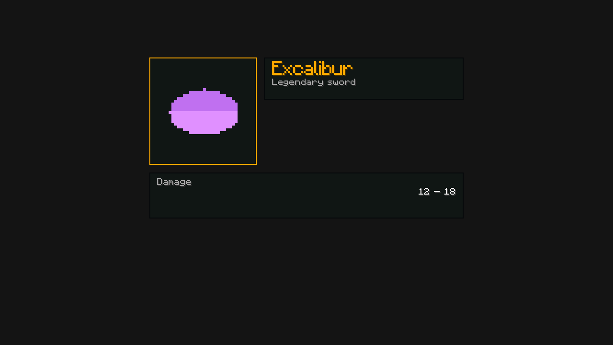

# DialogAPI

One Paper plugin that other plugins build their UI on. It offers three things and builds **one shared
resource pack** for all of them:

- **Action bar dialogs**: RPG style NPC text boxes (speaker tab, portrait, typewriter text, scrollable
  answers) drawn in the action bar. Create them in Java or YAML.
- **Dialog screens**: a typed wrapper around Paper's dialog API (the vanilla dialog window) with buttons,
  inputs and callbacks, plus **glyph canvases**: boxes, icons and text in several sizes, placed to the
  pixel inside a dialog body, a book page or the action bar.
- **A resource pack service**: DialogAPI generates the pack, serves it and sends it. Your plugin
  registers images and fonts; they become part of the same pack, with stable character codes.

DialogAPI ships no ready-made screens: it is the toolbox for making your own, such as item cards,
profiles, shop entries, quest logs or menus. [Example: building a card](#example-building-a-card) shows
how a card is made from boxes, icons and text in two sizes, using only the public API.

Players use an unmodded vanilla client. Supported: **Paper 1.21.9 up to 26.3** (Java 21 on 1.21.x, Java 25 on 26.x).




*(Rendered by the test suite's client simulator from the generated pack, vanilla font, GUI scale 3-4.)*

---

## Contents

1. [Versions](#versions)
2. [Building and installing](#building-and-installing)
3. [Serving the resource pack](#serving-the-resource-pack)
4. [Using the API in your plugin](#using-the-api-in-your-plugin)
5. [Action bar dialogs](#action-bar-dialogs)
6. [Dialog screens and glyph canvases](#dialog-screens-and-glyph-canvases)
7. [Example: building a card](#example-building-a-card)
8. [How the pack works](#how-the-pack-works)
9. [Commands and permissions](#commands-and-permissions)
10. [Limitations](#limitations)
11. [Publishing a release (maintainers)](#publishing-a-release-maintainers)
12. [Project structure and tests](#project-structure-and-tests)

---

## Versions

| | 1.21.9 / 1.21.10 | 1.21.11 | 26.1.x | 26.2 | 26.3 |
|---|---|---|---|---|---|
| Java on the server | 21 | 21 | 25 | 25 | 25 |
| Adventure | 4.25 | 4.26 | 4.26 | 5.2 | 5.2 |
| Resource pack format | 69 | 75 | 84 | 88 | 97 |

- 1.21.9 is the minimum: the portrait head is a `player` object text component (Minecraft 1.21.9+).
- The jar is compiled for Java 21 against Paper 1.21.11, so it loads on Java 21 and Java 25 servers.
  Paper's own API for 26.x is compiled for Java 25, which is why the build does not use it.
- `pack.mcmeta` only contains `min_format` 69 and `max_format` 97. Newer Minecraft versions need a
  higher `pack.max-format` in `config.yml`.
- The vanilla font sheets are identical in all these versions (checked against the real client jars).

## Building and installing

Requirements: Java 21 and the included Maven wrapper (Maven 3.9, downloaded on first use).

```bash
./mvnw package          # runs the tests, builds plugin/target/DialogAPI-1.0.0.jar
./mvnw install          # also installs dialogapi-api into ~/.m2 so your plugins can compile against it
./scripts/run-server.sh 1.21.11   # local test server in run/1.21.11 (you have to accept the EULA there)
```

Put `DialogAPI-1.0.0.jar` into `plugins/`. On the first start the plugin:

1. writes `config.yml`, `actionbar/` and the example `actionbar/dialogs/stats_house.yml`,
2. writes placeholder textures to `textures/`,
3. downloads the Minecraft client jar **once** from Mojang (about 30 MB, SHA-1 verified), extracts the
   vanilla font sheets into `cache/vanilla-font/` and deletes the jar (`font.source` in `config.yml`),
4. builds the resource pack into `pack/` and `DialogAPI-pack.zip` and logs its SHA-1.

```
plugins/DialogAPI/
├── config.yml                  font, typewriter, input, pack serving and formats
├── actionbar/
│   ├── layout.yml              HUD positions in GUI pixels
│   ├── bindings.yml            entity UUID / scoreboard tag -> dialog
│   └── dialogs/*.yml           your action bar dialogs (subfolders allowed)
├── textures/
│   ├── actionbar/              HUD textures (replace them freely) + portraits/ (64x64 skins) + pack.png
│   └── <plugin>/<id>.png       replaces an image another plugin registered
├── font/                       only with font.source: custom (or as fallback)
├── cache/vanilla-font/         extracted vanilla font sheets
├── codepoints.json             which character belongs to which glyph (do not delete, see below)
├── pack/                       the generated pack (rewritten on every build, don't edit)
├── DialogAPI-pack.zip
└── DialogAPI-pack.zip.sha1
```

## Serving the resource pack

Clients need the pack, otherwise they see boxes instead of the UI. The SHA-1 changes whenever a texture,
a layout, the font or anything another plugin registered changes. `/dialogapi pack` shows the current hash
and URL, and `DialogAPI-pack.zip.sha1` contains it.

### Option A: server.properties

Upload `DialogAPI-pack.zip` somewhere with a direct download link, then set:

```properties
resource-pack=https://example.com/DialogAPI-pack.zip
resource-pack-sha1=<contents of DialogAPI-pack.zip.sha1>
require-resource-pack=true
```

Re-upload the zip and update the SHA-1 after every change. Keep `pack.send-on-join: false`. To combine
it with another server pack, merge the `assets/` folders (DialogAPI uses `dialogapi` and one folder per
registering plugin). Glyphs keep their characters across rebuilds, so an old pack only misses *new* assets.

### Option B: the plugin sends it on join

```yaml
pack:
  send-on-join: true
  required: true
  url: "https://example.com/DialogAPI-pack.zip"   # where you uploaded the zip
```

The pack is sent with Paper's resource pack API and a fixed pack UUID, so a new version replaces the old
one on the client and other server packs stay. With `resend-on-change: true` a changed pack is sent to
everyone online. Upload the new zip *before* reloading, or the hash won't match the download.

### Option C: built-in web server

```yaml
pack:
  send-on-join: true
  self-host:
    enabled: true
    port: 8163                              # open this TCP port in your firewall
    public-url: "http://play.example.com:8163"
```

The zip is served from memory at `<public-url>/dialogapi-<sha1>.zip`. The hash in the URL means clients
never use a stale cached copy.

## Using the API in your plugin

Server owners install the `DialogAPI` plugin jar. Your plugin only compiles against the small API
artifact, so **nothing is shaded into your jar**. The API is published through
[JitPack](https://jitpack.io), which builds it from the git tags of this repository.

```xml
<repositories>
    <repository>
        <id>jitpack.io</id>
        <url>https://jitpack.io</url>
    </repository>
</repositories>

<dependency>
    <groupId>com.github.RohrJaspi.dialog-api</groupId>
    <artifactId>dialogapi-api</artifactId>
    <version>1.0.0</version>   <!-- a git tag of the repository -->
    <scope>provided</scope>    <!-- never shade it: the classes come from the DialogAPI plugin -->
</dependency>
```

Gradle:

```kotlin
repositories { maven("https://jitpack.io") }
dependencies { compileOnly("com.github.RohrJaspi.dialog-api:dialogapi-api:1.0.0") }
```

For a local build without JitPack run `./mvnw install` here and use `dev.dialogapi:dialogapi-api:1.0.0`
(local repository only). Declare the dependency in your plugin descriptor:

```yaml
# paper-plugin.yml
dependencies:
  server:
    DialogAPI:
      load: BEFORE
      required: true
      join-classpath: true
```

```yaml
# plugin.yml
depend: [DialogAPI]
```

Tell your users to install DialogAPI next to your plugin (link the release page). Because the classes
come from the installed plugin, several plugins share one DialogAPI and one resource pack.

Then `DialogAPI.get()` returns the services:

```java
DialogServices api = DialogAPI.get();
api.actionBar();        // action bar dialogs
api.screens();          // dialog screens
api.assets(this);       // add images and fonts of your plugin to the shared pack
api.pack();             // ready callbacks, SHA-1, URL, send
```

All API methods must be called on the main thread. `DialogAPI.get()` throws a clear
`IllegalStateException` if the plugin is not enabled or if your jar contains its own copy of the API.

## Action bar dialogs

### Creating dialogs in YAML

Every `.yml` file in `plugins/DialogAPI/actionbar/dialogs/` (subfolders included) is one dialog. The id
is the file name, or `id:` in the file. Reload with `/dialogapi reload`. Errors are logged with the
file and node name.

```yaml
speaker: "<gold>MaximDe"          # MiniMessage; omit for no name tab
portrait: MaximDe                 # optional, see below
typewriter: { mode: letter, speed: 1 }   # optional overrides of config.yml
max-distance: 10                  # optional, -1 = never end because of distance
start: welcome                    # optional, default: first node

nodes:
  welcome:
    text: "Welcome to the <aqua>Stats House</aqua>! Here you can look at the leaderboards of Duels."

  menu:
    question: "What do you want to know?"
    timeout: 400                  # optional, ticks
    default-answer: 3             # 1-based, chosen on timeout (omitted = the dialog ends)
    answers:
      - text: "How does that work?"
        goto: explain
      - text: "Give me the leaderboard!"
        commands: ["lb open %player%"]
        goto: bye
      - text: "Alright then!"
        end: true

  explain:
    text:                         # a list = one page per entry
      - "Every duel you play is recorded..."
      - "Walk up to a board and <green>right-click</green> it..."
    typewriter: { mode: word, speed: 3 }
    goto: menu

  bye:
    text: "Good luck out there!"
    advance: auto
    auto-delay: 40
    end: true
```

The full example with comments is `plugin/src/main/resources/actionbar/dialogs/stats_house.yml`.

**Text.** Text is [MiniMessage](https://docs.advntr.dev/minimessage/format.html): colors, gradients,
`<bold>`, `<italic>`, `<obfuscated>`, `<br>` for a line break, and `<player>` for the player's
name. The plugin wraps text to the box itself, using the exact glyph widths. Text that does not
fit into `max-lines` continues on the next page automatically. Underline and strikethrough are
removed (see [Limitations](#limitations)). Characters that are not in the font are replaced
with `?`.

**Node keys**

| key | meaning |
|---|---|
| `text` / `question` | string or list of pages. `question` (or `answers`) makes it a question node |
| `answers` | list of answers (question nodes) |
| `timeout`, `default-answer` | question timeout in ticks; 1-based answer used on timeout |
| `speaker`, `portrait` | override the dialog's speaker/portrait for this node (multi-character scenes) |
| `typewriter.mode` | `letter` or `word` |
| `typewriter.speed` | ticks between steps (0 = instant) |
| `typewriter.punctuation-delay` | extra ticks after `. ! ? …` (half after `, ; :`) |
| `typewriter.sound` | `{key, volume, pitch, pitch-variance, every: word\|letter}` or `none` |
| `advance` | `click` (wait for confirm) or `auto` |
| `auto-delay` | ticks before `advance: auto` continues |
| `commands`, `player-commands`, `messages` | run when the node **starts** (console / as player / chat message) |
| `goto` / `dialog` / `end` | where to go when a text node is done |

**Answer keys:** `text`, plus any of `commands`, `player-commands`, `messages`, and one of
`goto: <node>`, `dialog: <id>` (or `<id>#<node>`), `end: true`.

**Flow rule:** commands and messages run first, then the flow action. Without a `goto`, `dialog`
or `end`, the dialog continues with the **next node in file order**, and ends after the last
node. `%player%` and `%uuid%` are replaced in commands.

**Portraits**

| value | head shown |
|---|---|
| `portrait: MaximDe` | skin of that player name. The plugin looks it up once in the background and caches it |
| `portrait: 069a79f4-44e9-4726-a5be-fca90e38aaf5` | skin of that UUID |
| `portrait: "%player%"` | the player who is talking |
| `portrait: { texture: "eyJ0ZXh0dXJlcyI6..." }` | a base64 skin texture value, like custom heads (optional `signature`) |
| `portrait: { skin-file: maxim }` | `textures/portraits/maxim.png` (a 64x64 skin), shipped inside the pack |
| `portrait: { name: MaximDe, hat: false }` | without the hat layer |

### Java API

```java
import static dev.dialogapi.api.actionbar.Dialog.END;

Dialog dialog = Dialog.builder("stats_house")
        .speaker("<gold>MaximDe").portrait("MaximDe")
        .text("Welcome to the Stats House! Here you can look at the leaderboards of Duels.")
        .question("menu", "What do you want to know?")
            .answer("How does that work?", "explain")
            .answer("Show me the board!",
                    DialogAction.consoleCommand("lb open %player%"),
                    DialogAction.run(p -> p.sendMessage("Opening...")),
                    DialogAction.end())
            .answer("Alright then!", END)
            .timeout(20 * 20, 3)                   // after 20 s choose answer 3
        .text("explain", "Every duel you win gives you rating points.").then("menu")
        .build();                                  // validates node references

ActionBarDialogs dialogs = DialogAPI.get().actionBar();
dialogs.register(dialog);                          // startable by id, survives /dialogapi reload
dialogs.start(player, "stats_house");              // or start(player, dialog) without registering
dialogs.start(player, "stats_house", villager);    // with an NPC (click target + distance check)
dialogs.bind(villager, "stats_house");             // right-clicking the villager starts it
dialogs.stop(player);
```

Answer and `then(...)` targets are a node id, `Dialog.END`, or `"@dialog:<id>"` / `"@dialog:<id>#<node>"`.
Events: `DialogStartEvent` (cancellable), `DialogAnswerEvent` and `DialogEndEvent` (with an `EndReason`).

An entity starts a dialog on right-click if it was bound with `/dialogapi bind` / `ActionBarDialogs#bind`, its
UUID is listed in `bindings.yml`, or it has the scoreboard tag `dialog.<dialogId>`. The click is cancelled,
so villagers don't open their trade screen. Works with any real entity, including Citizens NPCs. For
packet-based NPC plugins, start the dialog with the NPC plugin's command action:
`dialogapi start stats_house %player%`.

### Player input

| action | input |
|---|---|
| select answer | **mouse wheel**, or number keys 1-9 |
| continue / confirm | **right-click the NPC**, even with an empty hand; or **sneak** |
| skip the typewriter | confirm while text is still appearing |

Scrolling is detected with `PlayerItemHeldEvent`. While the answer box is shown, the event is
cancelled, so the real hotbar slot never changes. Paper sends the old slot back to the client.
The delta handles the 8↔0 wrap-around. If the player scrolls again before that correction
arrives (within their ping), the delta is measured from the last reported slot instead.
Options in `config.yml` → `input`: confirm by clicking any entity, or by right-clicking anywhere
(`confirm-on-block-or-air-click`). The client sends no packet for a right-click on air with an empty
hand, so this option puts an invisible `interaction` entity around the player's head while a dialog
runs. Only that player sees it, and projectiles pass through it. Every click hits it, so while the
dialog is open, left-clicks can't break blocks or attack, and the block outline is hidden.

## Dialog screens and glyph canvases

### A screen with buttons and inputs

```java
Screen screen = Screen.builder(Component.text("Settings"))
        .body(ScreenBody.text(Component.text("Pick a mode"), 200))
        .input(ScreenInput.bool("pvp", Component.text("PvP"), false))
        .input(ScreenInput.slider("radius", Component.text("Radius"), 200, 1, 64, 16))
        .multiAction(2,
                ScreenButton.of(Component.text("Apply"), 100, click -> {
                    boolean pvp = Boolean.TRUE.equals(click.bool("pvp"));
                    click.player().sendMessage("radius " + click.number("radius"));
                }),
                ScreenButton.close(Component.text("Cancel"), 100))
        .build();
DialogAPI.get().screens().show(player, screen);
```

Callbacks run on the main thread and are single-use unless the button is `.asReusable()` (needed when the
screen stays open, `afterAction(NONE)`). `Screens#toPaperDialog` gives the Paper dialog if you need more.

### Your own images and fonts in the shared pack

```java
PackAssets assets = DialogAPI.get().assets(this);                        // in onEnable
GlyphRef icon  = assets.image("sword", ImageSource.resource(this, "textures/sword.png"), 0);
GlyphRef panel = assets.nineSlice("panel", ImageSource.resource(this, "textures/panel.png"), 4, 200, 80, 0);
TextFontRef big = assets.text(8, 2);                                     // letters 2x size, top at y = 8

DialogAPI.get().pack().whenReady(() -> {                                 // the handles exist after a build
    Component line = new GlyphCanvas()
            .glyph(panel, -100)                                          // x relative to the centre
            .glyph(icon, -90)
            .text("Excalibur", big, -60, NamedTextColor.GOLD)
            .build();                                                    // total advance is exactly 0
    DialogAPI.get().screens().show(player, Screen.builder(Component.text("Item"))
            .body(ScreenBody.canvas(line, 220, 80))                      // reserves the height of the drawing
            .notice(ScreenButton.close(Component.text("OK"), 100))
            .build());
});
```

- `top` is in GUI pixels below the top of the text line; negative values lie above it. In the action bar
  the reference is the action bar line, in a dialog body or a book it is the body line.
- Ids may only contain `a-z`, `0-9` and `_`. The namespace in the pack is your plugin's name, lower-cased.
- `TextFontRef#width`, `fit` and `sanitize` use the exact widths of the built pack, so text can be fitted
  and right-aligned to the pixel (`GlyphCanvas#text(text, font, slotX, slotWidth, HAlign.RIGHT, color)`, or a `TextSlot` from `assets.text(rect, ...)`).
- Tint: frames and icons drawn in white are tinted by `glyph(ref, x, tint)`.
- A server owner can replace any image with `plugins/DialogAPI/textures/<namespace>/<id>.png`.
- A broken registration (missing file, glyph too tall) is logged and skipped; it never breaks the pack of
  other plugins. Check `ResourcePackBuildEvent` or `GlyphRef#isResolved`.
- Registrations of a plugin that is disabled are dropped and the pack is rebuilt (not while the server stops).

## Example: building a card

The picture at the top is made with the public API only. The code is the test fixture
`plugin/src/test/java/dev/dialogapi/plugin/pack/DemoCard.java`, which the tests draw, measure and check against the
generated pack:

```
+--------+ +--------------------+
|  icon  | | title (2x)         |          three boxes, one of them 328 px wide (two 256 px slices)
|  96px  | | subtitle           |          a rim in white, tinted with the accent colour at runtime
+--------+ +--------------------+          an icon scaled 3x and centred, text in three rows
+--------------------------------+
| label                    value |
+--------------------------------+
```

### Layout helpers: split a `Rect`, do not add up coordinates

A `Rect` is a rectangle in GUI pixels: `x` is relative to the centre of the body (or the left edge of a book
page) and `y` is below the top of the first line. You split one big rectangle into rows and columns, and the
same rectangles drive both the registration (sizes, tops) and the drawing (positions):

| | |
|---|---|
| `Rect.centered(328, 168)` | a rectangle centred on the body, top edge at y = 0 |
| `rect.rows(gap, 112, 48)` / `rect.columns(gap, 112, Rect.FILL)` | split top to bottom / left to right; `FILL` takes what is left (at most one) |
| `rect.inset(8, 4)` | shrink by 8 px left and right, 4 px top and bottom |
| `rect.place(w, h, HAlign.CENTER, VAlign.MIDDLE)` | an element of a given size inside the rectangle |
| `assets.box(id, source, slice, rect)` | a nine-slice box that fills the rectangle |
| `assets.image(id, source, scale, area, HAlign, VAlign)` | an image aligned in an area; the x is resolved at draw time because its width is only known after the build |
| `assets.text(rect, scale, HAlign, VAlign)` | a line of text in a rectangle (the letters sit at its top, middle or bottom) |
| `canvas.glyph(placed)` / `canvas.text("...", slot, color)` | draw them; text is fitted with "…" and aligned inside its rectangle |

**1. Compute the layout and register the assets once** (in `onEnable`, and again after a reload if sizes changed):

```java
PackAssets assets = DialogAPI.get().assets(this);
ImageSource box = ImageSource.resource(this, "textures/box.png");          // 16x16, the corners stay 4 px

Rect card = Rect.centered(328, 168);
List<Rect> rows = card.rows(8, 112, 48);                                   // top part, bottom strip
List<Rect> top  = rows.get(0).columns(8, 112, Rect.FILL);                  // square panel | the rest
Rect panel   = top.get(0);
Rect nameBox = top.get(1).rows(0, 44, Rect.FILL).get(0);
Rect wide    = rows.get(1);
List<Rect> nameText = nameBox.inset(8, 4).rows(2, 16, 8);                  // title (2x letters), subtitle
List<Rect> wideText = wide.inset(8, 6).rows(2, 8, 8);                      // label, value

Placed panelBox = assets.box("panel", box, 4, panel);
Placed rim      = assets.box("panel_rim", ImageSource.resource(this, "textures/rim.png"), 4, panel);
Placed name     = assets.box("name", box, 4, nameBox);
Placed wideBox  = assets.box("wide", box, 4, wide);                        // 328 px: split into 256 px slices for you
Placed icon     = assets.image("icon", ImageSource.resource(this, "textures/icon.png"), 3,   // 3x upscaled
                               panel, HAlign.CENTER, VAlign.MIDDLE);
TextSlot title    = assets.text(nameText.get(0), 2, HAlign.LEFT, VAlign.TOP);
TextSlot subtitle = assets.text(nameText.get(1), 1, HAlign.LEFT, VAlign.TOP);
TextSlot label    = assets.text(wideText.get(0), 1, HAlign.LEFT, VAlign.TOP);
TextSlot value    = assets.text(wideText.get(1), 1, HAlign.RIGHT, VAlign.TOP);
```

**2. Draw it** once `DialogAPI.get().pack().whenReady(...)` has run (the handles are resolved after the first build):

```java
Component line = new GlyphCanvas()
        .glyph(panelBox)
        .glyph(rim, accent)                    // white texture, tinted: any colour you like at runtime
        .glyph(name)
        .glyph(wideBox)
        .glyph(icon)
        .text("Excalibur", title, accent)      // fitted to the rectangle with "…", aligned as the slot says
        .text("Legendary sword", subtitle, NamedTextColor.GRAY)
        .text("Damage", label, NamedTextColor.GRAY)
        .text("12 – 18", value, NamedTextColor.WHITE)
        .build();                              // total advance is exactly 0

Screen screen = Screen.builder(Component.text("Item"))
        .body(ScreenBody.canvas(line, card.width() + 32, card.height()))   // reserves the height of the drawing
        .notice(ScreenButton.close(Component.text("Close"), 100))
        .build();
DialogAPI.get().screens().show(player, screen);
```

Why it works, and what to watch:

- A canvas line has a total advance of 0, so the client starts drawing at the centre of the body and every
  `x` is relative to it. Draw the line in a **book page** instead and the same `x` values are relative to the
  left edge of the page (use `Rect.of(0, 0, 114, ...)` there).
- The vertical position of text is baked into the font (`assets.text(...)` registers one font per height and
  size); the vertical position of a box or icon is its `top`. Both are in GUI pixels from the top of the first line.
- The client scrolls a dialog that is taller than the window. A card of 168 px plus the title and the buttons
  fits at GUI scale 2 and 3; check yours at GUI scale 2, 3 and 4.
- Layout values that come from a config (box sizes, icon scale) belong into the registration: when the
  config changes, call `assets.clear()`, register again and keep drawing with the old handles until
  `whenReady` runs for the new ones. The glyph characters stay the same, so nothing flickers.
- Per-image customisation by the server owner needs no code: a file
  `plugins/DialogAPI/textures/<your plugin>/panel.png` replaces the `panel` image before it is stretched.
- The low-level calls (`assets.nineSlice(...)`, `assets.text(top, scale)`, `canvas.glyph(ref, x)`,
  `canvas.text(text, font, x, color)`) stay available when you need an exact pixel position.

## How the pack works

### Where the action bar and dialog bodies are drawn

The client draws action bar text centred, with its top edge **72 GUI pixels above the bottom of the
screen**, starting at `screenCentre - width/2`. A dialog body line is centred in the same way.

### Horizontal: offset characters, total advance 0

Every font of the pack contains a `space` provider with private-use characters that draw nothing and move
the cursor by ±1, 2, 4 … 1024 px (`U+E800-E80A` positive, `U+E820-E82A` negative). `GlyphCanvas` keeps a
cursor, inserts the offset characters needed to jump to each piece and finally jumps back to 0. The total
advance of the line is therefore **exactly 0**, so the client starts drawing at the centre and every x is
relative to the centre.

### Vertical: one font per height

A bitmap glyph is drawn with its top edge at `lineY + 7 - ascent`. The pack contains one font per requested
`(top, scale)` pair, `dialogapi:text/s<scale>_<m|p><top>`, all pointing at the same glyph sheets:

```
height = scale * (H + P)        H = sheet height, P = transparent rows added below every cell
ascent = 7 - top + scale * (A - 7)    A = sheet ascent
```

The client rejects `ascent > height`, so `P` is the smallest padding that satisfies every request, rounded
up to a whole number of texture pixels (the visible pixels keep their scale). Images and boxes are glyphs
too: the same trick with padding below the texture, split into 256 px slices when wider.

### Glyph widths

The server knows the exact width of every character: it is computed from the same bitmaps that go into the
pack, with the client's formula (rightmost non-transparent column, times `height/cellHeight`, rounded, `+ 1`),
per scale. That is what `TextFontRef#width` and the word wrapping of action bar dialogs use.

### Stable character codes

All glyphs live in the font `dialogapi:glyphs` as private-use characters starting at `U+E000` (skipping the
offset characters, continuing at `U+F0000`). `codepoints.json` remembers the character of every glyph
(`<namespace>:<id>@<top>#<slice>`) and never reuses one. So adding, removing or changing assets does not
renumber the others, and clients that still have the previous pack (for example because it is hosted
externally) only miss the new assets. Delete the file only if you want to start over.

## Commands and permissions

| command | permission | |
|---|---|---|
| `/dialogapi start <dialogId> [player]` | `dialogapi.admin` | start an action bar dialog (replaces a running one) |
| `/dialogapi stop [player]` | `dialogapi.admin` | stop it |
| `/dialogapi reload` | `dialogapi.admin` | reload config, layouts, bindings, dialogs; rebuild the pack |
| `/dialogapi list` | `dialogapi.admin` | list dialogs (click to start) |
| `/dialogapi bind <dialogId>` / `unbind` | `dialogapi.admin` | bind the entity you look at |
| `/dialogapi pack [send [player]]` | `dialogapi.admin` | show SHA-1 / URL, (re)send the pack |

Alias: `/dapi`. The vanilla `/dialog` command is no longer overridden.

## Limitations

- **Portrait size:** the head object is always 8x8 GUI pixels; the client offers no way to scale it.
- **Underline / strikethrough** are drawn by the client relative to the original action bar line, not the
  shifted glyph, so they are stripped from action bar dialog text.
- **Other action bar messages** briefly replace the HUD until the next refresh (≤ 1 s).
- **Hotbar:** while answering, the client's hotbar highlight may flicker for a frame when scrolling.
- **Text the font lacks** (e.g. CJK) is replaced with `?`; Unifont glyphs cannot be shifted vertically.
- **GUI scale:** a screen taller than the window scrolls; check your cards at GUI scale 2, 3 and 4.
- Folia is not supported (sessions are ticked with the global scheduler).

## Publishing a release (maintainers)

1. Replace `RohrJaspi` in `pom.xml` and this README, push the project to GitHub (repository `dialog-api`).
2. `git tag 1.0.0 && git push origin 1.0.0`. JitPack builds the tag on first request (open
   `https://jitpack.io/#RohrJaspi/dialog-api` and press *Get it*; the log shows the build).
3. Create a GitHub release for the tag and attach `plugin/target/DialogAPI-<version>.jar` (from `./mvnw package`)
   so server owners have a download. JitPack also serves it as `dialogapi-plugin`.
4. Keep versions semantic: breaking API changes need a new major version, so plugins built against 1.x keep working.

## License

GPL-3.0, see `LICENSE`. Note that the GPL can require plugins that link against the API to be GPL as well;
if you want closed-source or differently licensed plugins to use it, choose a more permissive license
(for example LGPL or MIT) before publishing.

## Project structure and tests

```
pom.xml                    parent
api/                       dev.dialogapi:dialogapi-api   what other plugins compile against (provided)
  dev.dialogapi.api            DialogAPI, DialogServices
  .actionbar                   Dialog, DialogBuilder, DialogAction, events, ActionBarDialogs
  .glyph                       PackAssets, GlyphRef, TextFontRef, Placed, TextSlot, ImageSource, GlyphCanvas, OffsetChars
  .layout                      Rect (split into rows / columns), HAlign, VAlign
  .screen                      Screen, ScreenBody, ScreenButton, ScreenInput, Screens
  .pack                        ResourcePack, ResourcePackBuildEvent
plugin/                    dev.dialogapi:dialogapi-plugin  the server plugin (the api classes are shaded in)
  pack/                        PackBuilder (one pipeline), GlyphAllocator, TextFontFactory, CodepointStore,
                               PackRegistry, PackService, PackHost, font sources, Images
  session/ render/ input/ ...  action bar dialogs (state machine, HUD renderer, word wrapping)
  screen/PaperScreens          Screen -> Paper dialog
```

`./mvnw verify` runs everything offline with the fallback pixel font. The test helpers
(`ActionBarSimulator`, `BodySimulator`) read the generated pack and draw components with the client's rules
(ascent ≤ height, 256 px limit, advances, bold, shadows, head object metrics) and write previews to
`plugin/target/preview/`. With the real font:

```bash
./mvnw test -Ddialogapi.cacheDir=/path/to/cache     # a folder containing vanilla-font/ (or vanilla-font-<version>/)
./mvnw test -Ddialogapi.vanillaVersions=1.21.9,1.21.11,26.2,26.3   # downloads those client jars, checks the font is identical
./mvnw -Pmin-api -DskipTests package                 # compile against the oldest supported API (1.21.10)
```
